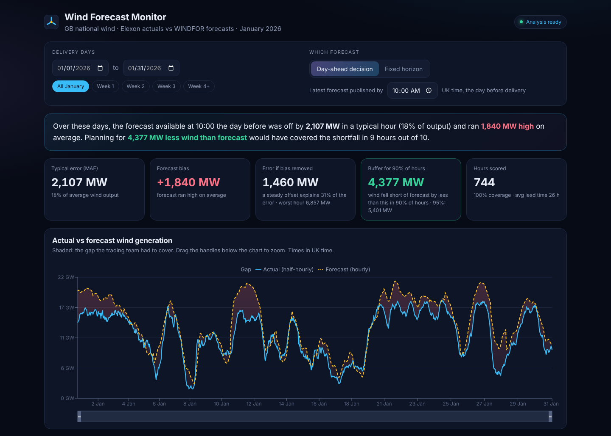

# Wind Forecast Monitor

A web app for a UK energy supplier's day-ahead trading team. It shows the **latest national wind
generation forecast that was available when buying**, next to what wind actually generated, and measures
**how far off the forecast was**, so the team can decide how much extra power to buy.

**Live app:** `https://qx7vrn.vercel.app`

**Data:** Elexon BMRS FUELHH (actual wind output) and WINDFOR (wind forecasts), January 2026.



## What it does

- **Day-ahead decision view (default):** for every hour of a delivery day, the newest forecast published by a
  chosen time on the day before (10:00 UK by default). This is what was on screen when the team bought power.
- **Fixed-horizon view:** for every hour, the newest forecast made at least *N* hours earlier (0–47 h).
- **Accuracy, in numbers:** typical error (MAE), bias, error with the bias removed, and the **buffer that would
  have covered 90% / 95% of hours**.
- **Accuracy, in charts:** error vs lead time, error by time of day, distribution of misses, and day-by-day bias.
- **Any date range** in January 2026, with weekly presets and a zoomable time-series chart.

Key findings for January 2026 (10:00 cut-off): the forecast was off by **2,107 MW** in a typical hour (18% of
output) and ran **1.84 GW high** on average. Wind came in below forecast in 84% of hours. A buffer of
**4.4 GW** covered the shortfall in 9 hours out of 10. Full write-up: [docs/analysis.md](docs/analysis.md).

## Run it

**With Docker** (only Docker needed):

```bash
docker compose up --build
# open http://localhost:8080
```

**Without Docker** (Python 3.12+, Node 22+):

```bash
# terminal 1: API on :8000
cd backend
python -m venv .venv && source .venv/bin/activate      # Windows: .venv\Scripts\activate
pip install -r requirements.txt -r requirements-dev.txt
uvicorn app.main:app --reload

# terminal 2: dashboard on :5173 (proxies /api to :8000)
cd frontend
npm ci
npm run dev
```

**Tests and checks:**

```bash
cd backend && ruff check . && pytest              # 19 tests: forecast selection, metrics, API
cd frontend && npm run typecheck && npm test      # 4 tests: chart data merge, formatting, headline
```

**Refresh the data from Elexon** (optional; the snapshot is committed):

```bash
cd backend && python scripts/fetch_data.py        # rewrites data/actuals.csv and data/forecasts.csv
python scripts/findings.py                         # prints every number used in docs/analysis.md
```

## How it works

```
Elexon BMRS API ──(scripts/fetch_data.py, once)──> backend/data/*.csv  (January 2026 snapshot)
                                                         │
                                         FastAPI (backend/app) ── /api/series, /api/accuracy
                                                         │
                         React dashboard (frontend) ─────┘   same origin: Vite proxy / nginx / Vercel rewrite
```

- **Snapshot, not live calls.** The app reads a committed CSV snapshot instead of calling Elexon on every
  request. Answers are fast and reproducible, and the demo still works if the public API is slow. One script
  refreshes it.
- **Forecast selection** (`backend/app/analysis.py`): for each target hour, the latest forecast published by
  the cut-off (or at least *N* hours before). Done with a vectorised filter plus "latest per target" in pandas.
- **Scoring:** forecasts are hourly and actuals half-hourly, so accuracy is scored only on hours that have both.
  Nothing is interpolated. Error = forecast − actual, so positive means wind came in short.
- **Scope rules from the brief:** wind only, national level, target hours in January 2026, and forecasts made
  0–48 h ahead.
- **API:** `GET /api/series` (chart data) and `GET /api/accuracy` (metrics and breakdowns), both taking
  `start`, `end`, `mode=cutoff|horizon`, `cutoff=HH:MM` and `horizon=0..48`. Invalid input gets a 422. Results
  are cached per query, and interactive docs are at `/docs`.

## Files and directories

```
backend/
  app/main.py            FastAPI app: endpoints, input validation, caching
  app/analysis.py        forecast selection and accuracy metrics (pure functions, unit-tested)
  app/data.py            loads the CSV snapshot
  app/elexon.py          Elexon API client (chunked requests, retries)
  data/actuals.csv       1,488 half-hours of actual wind output (FUELHH, fuelType WIND)
  data/forecasts.csv     11,873 forecast values (WINDFOR, January targets, 0-48 h ahead)
  scripts/fetch_data.py  rebuilds the snapshot from Elexon
  scripts/findings.py    prints every number quoted in docs/analysis.md
  tests/                 pytest: analysis and API
  Dockerfile             API image (uvicorn, non-root user, health check)
frontend/
  src/App.tsx            page layout and state
  src/components/        controls, KPI cards, main chart, accuracy charts
  src/lib/               typed API client, data-loading hook, number/time formatting
  tests/                 vitest
  Dockerfile, nginx.conf static build served by nginx, /api proxied to the backend
api/index.py             Vercel serverless entry point (reuses backend/app)
vercel.json              Vercel build, function and routing config
requirements.txt         Python dependencies for the Vercel function
docker-compose.yml       backend + frontend, dashboard on :8080
.github/workflows/ci.yml lint, tests, build, Docker smoke test on every push
docs/analysis.md         findings and method
docs/screenshot.png      the dashboard
```

## Development practices

- **Small, testable core:** the analysis is pure functions with unit tests on hand-built cases, such as which
  forecast is picked at a horizon, cut-off edges, and metric values.
- **API contract tests:** row counts, validation errors and the no-look-ahead rule (every selected forecast was
  published before its cut-off) are all tested.
- **Typed frontend:** strict TypeScript with a typed API client. Stale requests are cancelled when filters
  change, and there are loading, error and empty states.
- **CI on every push:** ruff, pytest, typecheck, vitest, production build, then the Docker stack is built and
  smoke-tested through nginx.
- **Reproducible analysis:** the data snapshot and the script behind every quoted number are in the repo.

## Use of AI tools

## Use of AI tools

AI tools (Claude, by Anthropic) were used to assist with this project, mainly
for code suggestions, boilerplate and documentation drafts. All code was run
and tested against the real Elexon data; every number in the docs is
reproducible with `backend/scripts/findings.py`, and the tests and CI checks
in this repo verify the behaviour.
